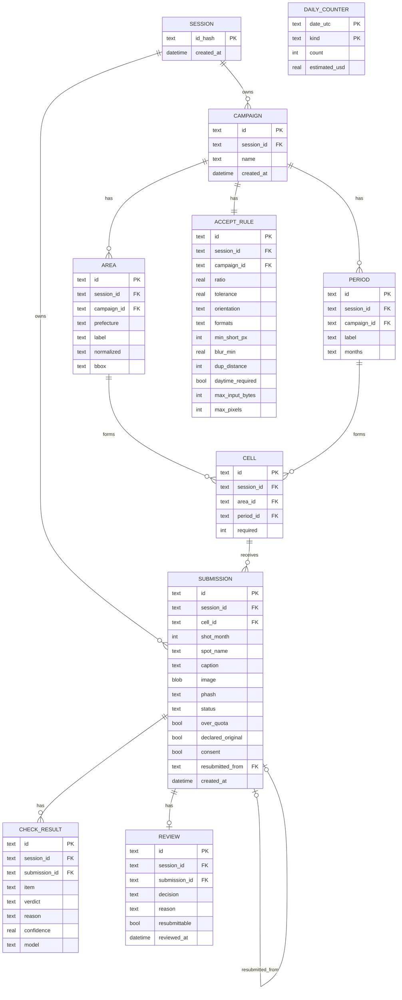
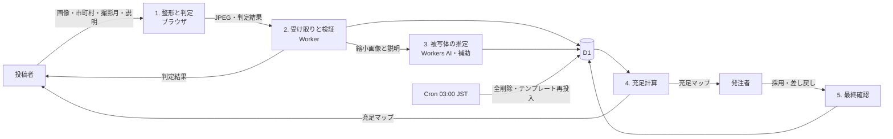
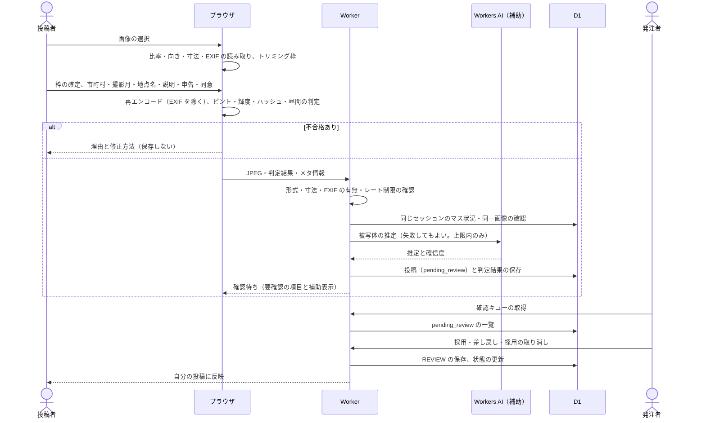
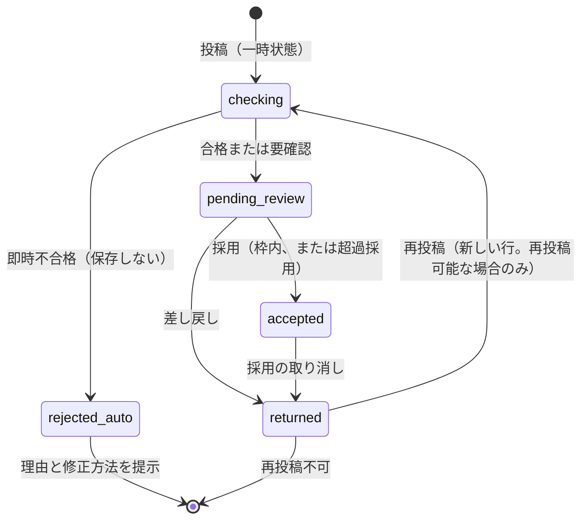
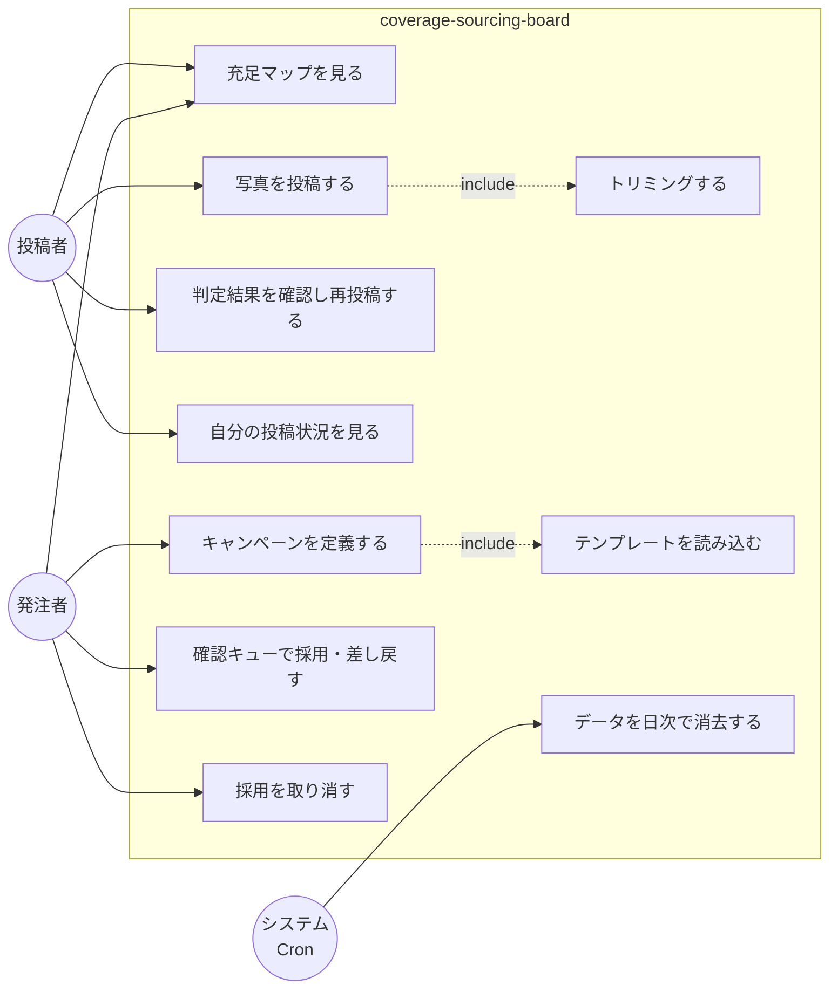

# coverage-sourcing-board（デモ版）要件書

- 版：草案 2
- リポジトリ名：`coverage-sourcing-board`
- 対象エディション：デモ版（アイデアの視覚化）
- 公開設定：public
- プラットフォーム：Cloudflare（Workers・Pages・D1・Cron Triggers・Workers AI）のみ
- 分類器：`@cf/cloudflare/clef-flash`（Workers AI）。画像を入力できる分類器を、被写体区分の補助に使う
- 参照日：2026-10-15（Cloudflare の料金・上限の確認日）

---

## 1. 課題と解決方針

### 1.1 課題
特定エリア×季節の風景写真を、条件を満たす数だけ集めたい。募集要項（エリア一覧・投稿条件・受入できない条件）を文章で書いて人を集め、届いた投稿を一枚ずつ人手で確認している。要項の多くは機械的に判定でき、どのマスが足りないかも投稿データから算出できる。

### 1.2 汎化
本件を次の一般形として扱う。

> **カバレッジ充足型の素材調達**：発注者が「区分軸（例：エリア）×時間軸（例：季節）」のマス目と、各マスの必要数・受入条件を定義する。投稿者は空いているマスを見て投稿し、受入条件の機械判定を通過したものだけが人の最終確認に回る。

写真以外や、エリア以外の区分軸にも同じ構造で適用できる。デモ版では「画像×エリア×季節」の1パターンのみ実装する。

### 1.3 人手の作業の置き換え
| 人手で行っていたこと | デモ版での置き換え |
|---|---|
| 募集エリアの文章による列挙 | マス目（エリア×季節）を投稿画面にそのまま表示 |
| どこが足りないかの周知 | 充足マップで未充足マスを常時表示 |
| 投稿条件の説明 | 投稿時の即時判定と、不合格理由の具体的な提示 |
| 一次検収 | 機械判定（比率・向き・形式・解像度・ピント・昼間・重複） |
| 不可時の連絡・再投稿の依頼 | 判定結果画面で理由と修正方法を示し、その場で再投稿 |

### 1.4 プラットフォーム選定理由
成果物を直接操作するのは人間（発注者・投稿者）であり、画像のアップロード・判定・集計という動的処理を伴うため、ウェブを選択する。スマートフォンでの撮影が多いため、インストール不要でスマートフォンのブラウザから使えることを重視する。画像の判定はブラウザ側（Canvas）で実行し、サーバー側には重い処理を持たせない。

---

## 2. デモ版の範囲

### 2.1 含む
- キャンペーン（マス目と受入条件）の作成。初期データとして「四国 風景写真」のテンプレートを同梱する
- 画像の投稿と、ブラウザでの一次判定
- 充足マップ（マスごとの採用数／必要数）
- 発注者による最終確認（採用・差し戻し・採用の取り消し）
- 被写体区分の補助表示（確認画面に推定を表示する。不合格にはしない）
- 全デモ共通の要素（4 要素・GA4・日本語のページタイトル・ライトテーマ固定・`/legal`）
- 投稿時の同意チェック

### 2.2 含まない
- 支払い、買取、権利の譲渡。採用の表示は「採用（デモ）」とし、画面に「実際の買取や権利の移転は行わない」と明記する
- 会員登録・認証
- 他サイトへの掲載有無の照合（外部通信が必要なため）
- 画像生成AIによる判定（確実な判定手段がないため、申告と人の確認で扱う）
- 位置情報（GPS）の保存。判定の中でだけ使い、保存しない

### 2.3 制約
- **認証なし。** セッションをオーナーキーとして、全テーブルのデータを区別する。
  - Cookie 名は `csid`。値は暗号学的乱数（128 bit 以上）をサーバーで発行する。
  - データベースには Cookie 値そのものではなく、そのハッシュだけを保存する。
  - Cookie の属性は HttpOnly・Secure・SameSite=Lax・Max-Age 86400 秒とする。
  - 毎日の全削除（3.9）でセッションも消え、以後は新しいセッションになる。
  - 1 セッション内で発注者と投稿者の両役を切り替えて体験する展示物とする。**他セッションのデータ（マスの件数を含む）は表示しない。**
- **データベースは D1（SQLite）。** 毎日 03:00（日本時間）に全削除し、テンプレートを再投入する（3.9）。
- **外部 API は使わない**（分類器を除く）。分類器は Cloudflare Workers AI を Workers から呼び出す。
  - Workers AI は無料プラン固定（1 日 10,000 Neurons）。超過した呼び出しはエラーで停止し、課金は発生しない。
- **位置情報と機種情報は保存しない。** 撮影地の市町村の一致と、撮影月だけを保存する。
- **個人情報**（氏名・メール・住所・電話・生年月日）は扱わない。地点名は任意入力とし、市町村名を含めて 20 字以内とする。
- **乱用対策**：3.8 の上限を適用する。ハニーポット欄は補助として設置する。

---

## 3. 機能仕様

### 3.0 既定値
以下は既定値である。実測の結果に応じて調整し、調整の内容は記録する。

| 項目 | 既定値 | 結果 |
|---|---|---|
| アスペクト比 | 4:3（許容誤差 ±1%） | 外れは不合格（トリミングを案内） |
| 向き | 横向きのみ | 縦向きは不合格（自動変換しない） |
| 入力ファイル | 5 MB 以下、JPEG または PNG | 外れは不合格 |
| 入力画素数 | 4,000 万画素以下 | 超えは不合格 |
| 最小短辺 | 800 px | 下回ると不合格 |
| JPEG 品質の推定（量子化テーブル） | 50 未満は不合格、50〜59 は要確認 | |
| ピント（縮小 512 px のラプラシアン分散） | 30 未満は不合格、30〜60 は要確認 | |
| 昼間の推定（EXIF の日時がある場合） | 日の出〜日の入りの外は不合格 | EXIF が無い場合は、平均輝度 40 未満を要確認 |
| 同一画像（知覚ハッシュの距離） | 4 以下は不合格、5〜8 は要確認 | |
| 同一地点（地点名の一致） | 一致は要確認。地点名が空欄なら判定しない | |
| 保存中の投稿の総数（全体） | 200 件まで。超えたら新規投稿を一時停止 | 追加の既定値（3.8） |
| 保存画像 | 長辺 1,600 px 以下、JPEG、2 MB 以下 | |
| 分類の確信度 | 0.6 未満は「判定が確かでない」と表示 | 補助表示のみ |

### 3.1 `defineCampaign`（キャンペーンの定義）
- 入力：名称、区分軸の値（例：市町村）、時間軸の値、マスごとの必要数（一律または個別）、受入条件。
- 時間軸の値：春（3〜5 月）、夏（6〜8 月）、秋（9〜11 月）、冬（12・1・2 月）。冬は年末年始をまたいでも同一の季節とする。
- 区分値は表記ゆれを正規化する（全角・半角、「・」区切りの複合地域は 1 つの値として保持する）。重複は拒否する。
- 受入条件の項目：アスペクト比、向き、許容形式（JPEG・PNG）、最小短辺、昼間（必須）、季節と月の整合、同一地点の扱い。
- 出力：キャンペーン ID とマス目の一覧。

### 3.2 `prepareImage`（投稿前の整形）
- 比率が条件と異なる場合は、中央基準の 4:3 トリミング枠を表示し、投稿者が位置を調整して確定する。
- 縦向きの画像は、回転せず「縦向きは不可」として扱う。
- EXIF はブラウザで読み取り、次の用途に限って使う。撮影月（申告との照合）、撮影地の市町村（3.3 の照合）、昼間の判定。**判定が済んだら破棄する。**
- 保存するのは、Canvas で再エンコードした JPEG（長辺 1,600 px 以下）だけとする。再エンコードにより、EXIF は残らない。
- Worker は受け取った JPEG の APP1（EXIF）セグメントの有無を検査し、あれば拒否する。Worker は画像を再エンコードしない（Workers の CPU 時間の制限のため）。
- SVG は受け付けない。

### 3.3 `validateSubmission`（一次判定）
判定の結果は、次の 3 つに分ける。

- **不合格**：投稿を保存しない。理由と修正方法を返す。
- **要確認**：投稿を「確認待ち」として保存し、発注者の確認キューに入れる。
- **補助**：不合格や要確認の根拠にはしない。確認画面に表示するだけ。

| 項目 | 結果 |
|---|---|
| 形式 | 不一致は不合格 |
| 向き・比率 | 外れは不合格（トリミングを案内） |
| 解像度・JPEG 品質 | 3.0 の下限を下回ると不合格。下限の近くは要確認 |
| ピント | 3.0 の下限を下回ると不合格。下限の近くは要確認 |
| 撮影地 | 不合格はない。EXIF の GPS から求めた市町村と申告が一致しなければ要確認。GPS が無い場合は申告を採用する |
| 撮影月・季節 | 撮影月の申告は必須。季節は月から導出する。EXIF の月と不一致なら要確認 |
| 昼間 | EXIF の日時がある場合、範囲外は不合格。EXIF が無い場合は平均輝度で判定し、暗い場合は要確認 |
| 加工 | 彩度・コントラストの極端な偏りは要確認。文字入れ・モザイクは機械判定しない |
| AI 生成・他サイト利用 | 投稿者の申告は必須入力（未チェックは投稿できない）。EXIF に機種情報が無い場合は要確認 |
| 同一画像 | 3.0 の既定値に従う |
| 同一地点 | 3.4 に従う（要確認） |
| 被写体区分 | 補助（3.5）。不合格や要確認の根拠にしない |

- 不合格が 1 つでもあれば、投稿は保存しない。理由と修正方法の一覧を返す。
- 要確認のみ、または全項目が合格の場合は「確認待ち」として保存する。
- 採用の最終判断は、常に発注者が行う。

### 3.4 `checkDuplicate`（重複の判定）
- 同一画像：知覚ハッシュ（縮小グレースケールの差分ハッシュ）を比較する。距離は 3.0 の既定値に従う。
- 同一地点：同じマス（同じ市町村×同じ季節）内で、地点名を正規化したうえで一致するものを要確認とする。地点名が空欄の投稿は、この判定を行わない。確認画面には既存の投稿を並べて表示する。
- 比較の対象は**同じセッション内の投稿だけ**とする（2.3）。
- 季節が異なれば、同一地点でも重複扱いしない（マスが異なるため）。
- 座標による距離の判定は行わない（座標を保存しないため）。

### 3.5 `classifySubject`（被写体区分の補助）
- **目的**：発注者の確認画面に、写真の主被写体の推定を補助として表示する。**不合格や要確認の根拠にはしない。**
- **モデル**：`@cf/cloudflare/clef-flash`（Workers AI）。画像を入力できる。
- **入力**：512 px に縮小した JPEG 1 枚（`images` に data URL で渡す）、投稿者の説明文（60 字以内。データとして扱い、命令として解釈させない）、撮影月。
- **質問**：`subject`（choice）。選択肢は次のとおり。
  - `landscape`：風景全体
  - `closeup`：花・木・物の接写
  - `people`：人物が主体
  - `other`：その他
- **出力**：推定区分と確信度。`CHECK_RESULT` に `verdict=info` として保存する。
- **失敗時**：分類が失敗した場合、または上限に達した場合は、投稿は受け付ける。確認画面には「被写体の推定はありません」と表示する。分類の失敗で投稿を止めない。
- **呼び出しの台帳**：呼び出しごとに、UTC の日付単位で件数と推定費用を `DAILY_COUNTER` に記録する。上限（3.8）に達したら、呼び出しを行わない。
- **精度の注意**：合成写真 40 枚（各区分 10 枚）での正答率は 65% であった（人物 50%、その他 20%。誤りの多くは「風景」への判定）。補助表示に限り、判定の根拠にはしない。
- **費用の見積もり**：1 回あたり約 1,200 入力トークン。単価は `clef-flash` の入力 $0.038／100 万トークン、出力は無料（公式の料金ページ、参照日 2026-10-15）。1 回の費用は約 $0.0000457、約 4 Neurons。

### 3.6 `computeCoverage`（充足計算）
- マスごとに「採用数／確認待ち数／必要数」を集計する。
- 充足率の低い順、必要数との差の大きい順に並べた「いま求めている場所」の一覧を作る。
- 採用数が必要数に達したマスは「募集終了」と表示し、新規の投稿を受け付けない。
- 確認待ちは枠に含めない（枠は採用の時点で判定する）。

### 3.7 `reviewSubmission`（最終確認）
- 発注者は、確認待ちの投稿を、要確認の項目と理由つきで一覧表示する。被写体の推定（3.5）も補助として表示する。
- 操作は次のとおり。
  - **採用**：枠内なら採用する。枠を超える場合は確認ダイアログを挟み、「超過採用」として記録する。
  - **差し戻し**：理由を選択し、自由記述を添える。「再投稿で対応可能か」を付け、投稿者の画面に修正の依頼として表示する。
  - **採用の取り消し**：採用済みの投稿を差し戻し扱いにする。枠が空けばマスは再び募集中になる。
- 差し戻しの理由の選択肢（仮置き。公開前に文言を確定する）：比率が条件と異なる、解像度が足りない、撮影地・撮影月の申告が合わない、被写体が条件に合わない、その他（自由記述）。

### 3.8 乱用対策
- **IP 単位**：投稿と分類の API 全体で 10 秒に 5 回まで。超えた場合は 429 を返す（Cloudflare の WAF レート制限ルール。無料プランは 1 ルール）。
- **セッション単位**：1 日 20 件まで（UTC 0 時に数え直す）。セッションは毎日 03:00（日本時間）の全削除で消えるため、実際にはその時刻で区切られる。
- **分類**：全体で 1 日 2,000 回まで（UTC 0 時にリセット）。上限に達したら、投稿は受け付けるが、被写体の推定は表示しない（3.5）。
- **保存中の投稿の総数**（追加の既定値）：全体で 200 件まで。超えたら新規の投稿を一時停止する。1 件あたりの画像を最大 2 MB とし、無料プランの DB サイズ（500 MB）に収めるため。
- **ハニーポット欄**：補助として設置する。
- 上限の数値は既定値であり、運用の実績に応じて見直す。

### 3.9 日次の全削除
- **実行**：Cron Trigger `0 18 * * *`（UTC）。日本時間の 03:00 に当たる。
- **手順**：全テーブルの投稿系の行（判定結果、レビュー、投稿、セッション）を、子から親の順に削除する。続けて、キャンペーン・エリア・期間・マス・受入条件のテンプレートを削除し、テンプレートを複数行の INSERT で再投入する。分類の日次カウンタ（3.5）は、この実行では初期化しない（UTC 0 時のリセットに従う）。
- **制約**：1 回の実行のクエリ数は約 15 とし、Workers 無料プランの上限（1 呼び出しあたり 50）に収める。CPU 時間（10 ms）に収まるかは、本番で確認する（12.4）。
- **表示**：画面に「データは毎日 03:00（日本時間）に消去されます」と表示する。分類の上限に達したときは、「分類は日本時間の 9 時に再開します」と表示する。

---

## 4. 画面一覧

| 画面 | 役割 | 主な要素 |
|---|---|---|
| トップ | 共通 | 役割の切替（発注者・投稿者）、データの消去時刻の表示 |
| 充足マップ | 共通 | エリア×季節の表、マスごとの採用数／必要数、未充足の強調 |
| 投稿 | 投稿者 | 画像の選択、トリミング枠、市町村・撮影月・地点名（任意）・一行説明、申告チェック、同意チェック、ハニーポット欄 |
| 判定結果 | 投稿者 | 項目ごとの合格・不合格・要確認、修正方法 |
| 自分の投稿 | 投稿者 | 状態（確認待ち・採用（デモ）・差し戻し）、差し戻しの理由 |
| キャンペーン設定 | 発注者 | マス目、必要数、受入条件の編集、テンプレートの読み込み |
| 確認キュー | 発注者 | 要確認の理由、被写体の推定（補助）、重複候補の並列表示、採用・差し戻し・採用の取り消し |
| `/legal` | 共通 | 利用規約・免責事項・連絡先。内容は全デモ共通（デモ目的、データ消去の方針、連絡先）。デザインはテーマに合わせる |

- 採用の表示は「採用（デモ）」とし、画面に「実際の買取や権利の移転は行わない」と明記する。

### 4.1 全デモ共通の要素
- **アンバーバナー**：ページの最上部に「これはデモ版です。データはサーバー再起動時にリセットされる場合があります。」を表示する。続けて「本デモは毎日 03:00（日本時間）にもデータを消去します。」を表示する。
- **ヘッダーの戻るリンク**：ナビの右端に「← デモ一覧へ」（区切り線付き）。リンク先は `https://rictaworks.jp/#demos`。
- **右下固定のボタン**：`position: fixed; bottom: 1.5rem; right: 1.5rem;` の吹き出しボタン「ご相談はこちら」。リンク先は `https://rictaworks.jp/`。
- **`/legal` ページ**とフッターのリンク。
- **GA4**：測定 ID `G-C04W1XKS16`。
- **ページタイトル**：日本語で設定する。
- **テーマ**：ライト固定。`color-scheme: light` を指定し、`prefers-color-scheme` による分岐は実装しない。
- **テーマの選定**：未決。実装の前に決め、名前を記載する。

### 4.2 文言
- 画面の文言は仮置きで進め、公開前に確定する。
- 不合格の理由、修正方法、差し戻しの理由、`/legal` の本文、案内文は、確定の前に事実を整理してから文言を作る。

---

## 5. 構成要件（設計原則）

- 不合格にするのは、投稿者がその場で直せる項目（比率・向き・形式・解像度・ピント・昼間・同一画像・撮影月の未入力）に限る。
- 要確認にするのは、機械判定だけでは決められない項目（加工の偏り、EXIF の不足、撮影地の不一致、同一地点、申告の確認）に限る。
- 被写体区分は、不合格にも要確認にも使わない（補助のみ）。
- 季節は月から導出する。投稿者に季節を別に入力させない。
- 複合地域（「A 町・B 町」など）は、募集上は 1 マスとして扱う。判定ではどちらの町でも合格とする。
- 区分軸の値は、キャンペーン定義の選択肢からのみ選ばせる。
- 画像は判定後に再エンコードして保存する。原寸は保存しない。EXIF は残さない。
- 判定ロジックはブラウザで実行する。Worker は、形式・寸法の上限・EXIF の有無・件数の上限だけを検証する（クライアントの改ざん対策）。
- 位置情報は保存しない。撮影月のみ保存する。
- 投稿者の入力（地点名・説明文）は、テキストとして描画する。HTML を組み立てない。

---

## 6. ER 図

- 全テーブル（`DAILY_COUNTER` を除く）に `session_id` を持たせ、すべてのクエリ条件に含める。テンプレートの行は、固定のシステム用 ID を `session_id` に持たせ、利用者のクエリには含めない。
- `DAILY_COUNTER` は全体で 1 つ（日付と種類ごと）とし、セッションに紐づけない。
- `SUBMISSION.status`：`checking`（保存前の一時状態）・`pending_review`・`accepted`・`returned`。即時不合格の投稿は保存しない。
- 再投稿は新しい行とし、`resubmitted_from` で元の投稿を指す。
- マスタデータの件数（テンプレート）：エリア 21（徳島 6・香川 5・愛媛 3・高知 7。複合表記は 1 件）、期間 4、マス 84、受入条件 1。
- 位置情報（緯度・経度）と機種情報は持たない。

---

## 7. データの流れ

---

## 8. 投稿から採用までの流れ

---

## 9. クラス図（Domain Core）

```mermaid
classDiagram
    class Campaign {
      +id
      +name
      +areas: Area[]
      +periods: Period[]
      +rule: AcceptRule
      +cell(areaId, periodId) Cell
    }
    class Area { +label +normalized +bbox +contains(lat,lng) bool }
    class Period { +label +months +fromMonth(m) Period }
    class Cell { +required +isFull(acceptedCount) bool }
    class AcceptRule { +ratio +tolerance +orientation +formats +minShortPx +blurMin +dupDistance +daytimeRequired +maxInputBytes +maxPixels }
    class ImageFeatures { +width +height +format +quality +blurScore +meanLuma +phash }
    class Submission { +cellId +shotMonth +spotName +caption +features +status +overQuota }
    class CheckResult { +item +verdict +reason +confidence }
    class Validator { +validate(sub, rule) CheckResult[] }
    class DuplicateChecker { +check(sub, existing) CheckResult }
    class SubjectHint { +suggest(imageSmall, caption, month) CheckResult }
    class CallLedger { +reserve(kind) bool +record(kind, tokens, usd) }
    class SunCalculator { +isDaytime(date, lat, lng) bool }
    class CoverageCalculator { +compute(campaign, subs) CellStatus[] }
    class ReviewService { +accept(sub) +returnBack(sub, reason, resubmittable) +revoke(sub) }

    Campaign "1" o-- "*" Area
    Campaign "1" o-- "*" Period
    Campaign "1" o-- "*" Cell
    Campaign "1" o-- "1" AcceptRule
    Submission --> ImageFeatures
    Submission "1" o-- "*" CheckResult
    Validator --> SunCalculator
    Validator --> DuplicateChecker
    CoverageCalculator --> Campaign
    ReviewService --> Submission
    SubjectHint --> CallLedger
```

- `Validator`、`DuplicateChecker`、`SunCalculator`、`CoverageCalculator` は、外部に依存しない純粋な関数とする。
- `SubjectHint` だけが外部（Workers AI）に依存する。インターフェースで差し替えられるようにし、結果は補助として扱う。
- `CallLedger` は、外部呼び出しの前に件数を予約し、上限を超える場合は呼び出さない。

---

## 10. 状態遷移図

### 10.1 投稿

### 10.2 マス
- 募集中（採用数 < 必要数）→ 募集終了（採用数 ≥ 必要数）。
- 採用を取り消すと、採用数が必要数を下回り、再び募集中になる。
- 超過採用は、確認ダイアログの後に限り認める。

---

## 11. ユースケース図

---

## 12. 技術構成

### 12.1 構成
| 層 | 採用 |
|---|---|
| フロント | Cloudflare Pages（Next.js の静的出力、TypeScript） |
| API | Cloudflare Workers（TypeScript） |
| DB | Cloudflare D1（SQLite） |
| 補助の分類 | Workers AI `@cf/cloudflare/clef-flash`（無料プラン） |
| 日次の全削除 | Workers Cron Trigger（UTC 18:00＝JST 03:00） |
| 画像の判定 | ブラウザの Canvas と EXIF の読み取り（クライアント内で完結） |
| 市町村の境界 | 対象市町村の矩形（bbox）を静的に同梱する。出典とライセンスを確認するまで公開しない（12.5） |

### 12.2 無料プランの前提（2026-10-15 確認）
| 項目 | 上限 | 超過時 | 出典 |
|---|---|---|---|
| D1 の DB サイズ | 1 DB あたり 500 MB、アカウント全体で 5 GB | 書き込みが止まる | D1 の上限のページ |
| D1 の行・BLOB・文字列 | 1 行あたり 2 MB | 書き込みが失敗する | 同上 |
| D1 の呼び出しあたりのクエリ数 | 50 | 処理が失敗する | 同上 |
| Workers の CPU 時間 | 1 リクエストあたり 10 ms（Cron も同じ） | 処理が止まる | Workers の上限のページ |
| Workers AI | 1 日 10,000 Neurons（UTC 0 時にリセット） | エラーで停止（課金なし） | Workers AI の料金ページ |
| Workers AI の単価（`clef-flash`） | 入力 $0.038／100 万トークン、出力は無料 | — | 同上 |
| Cron Trigger | アカウントあたり 5 個 | — | Cron の上限のページ |
| WAF のレート制限 | 1 ルール、期間は 10 秒 | — | WAF の上限のページ |

### 12.3 規模
- 判定の項目 12 行（3.3。被写体区分の補助を含む）、関数 7、画面 8（4 章の表）、テーブル 9 と日次カウンタ 1（6 章）、外部連携 1（Workers AI）、Cron 1。
- 1 つの issue で実装するか、分割するかは判断が必要。

### 12.4 完了の条件
1. 全デモ共通の要素（4.1）が、機械的な検索で確認できる（4 要素、GA4、日本語タイトル、ライトテーマ）。
2. 投稿の上限（3.8）と、分類の上限と台帳が動作する。
3. 毎日の全削除（3.9）が本番で動き、CPU 時間とクエリ数が上限内に収まったことを、ログで確認する。
4. 保存された画像に EXIF（APP1）が残っていないことを確認する。
5. 分類の正答率を、実写の写真で測り直す。合成写真だけの結果では、補助表示の根拠にしない。
6. コミット前にセキュリティレビューを通す。

### 12.5 境界データ
- 市町村の矩形（bbox）は、出典とライセンスを確認し、出典の表記とともに同梱する。確認できるまでは公開しない。
- 確認できない場合は、市町村の照合を行わず、撮影地の判定を要確認に固定する。

### 12.6 デプロイ
- 反映はデスクトップから行う（Workers Builds は使わない）。
- Cloudflare の API トークンは、このリポジトリ専用に発行する。デプロイに必要な権限は、実装の前に確認する。

---

## 付録：未決の事項

1. 実写の写真（各区分 10 枚以上）による分類の再測定。
2. 3.0 の既定値の実測による調整（追加の上限「保存中の投稿の総数 200 件」を含む）。
3. 境界データの出典とライセンスの確認（12.5）。
4. 1 つの issue の規模（12.3）の判断。
5. テーマの選定（4.1）。
6. デプロイに必要な権限の確認（12.6）。
